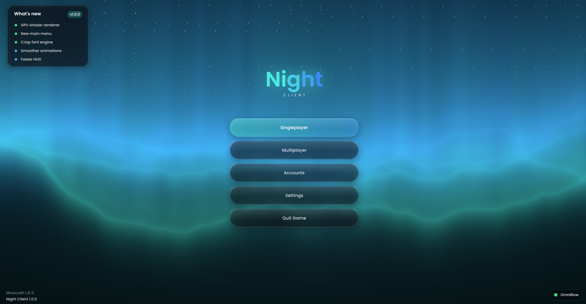
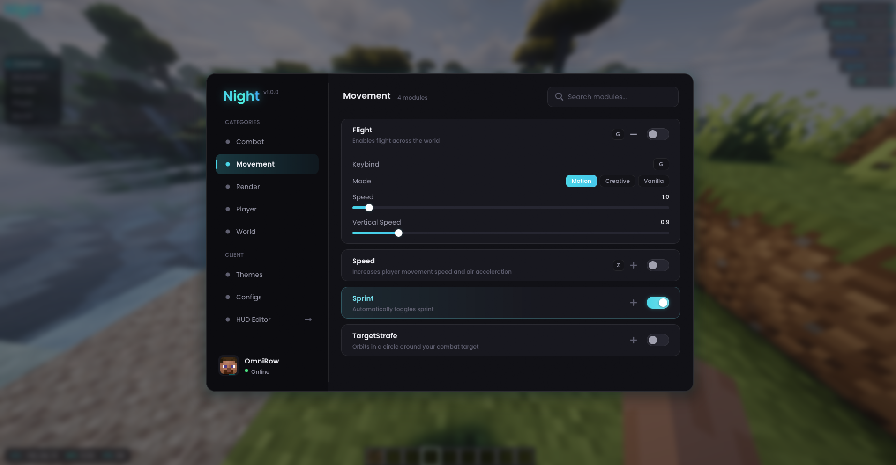
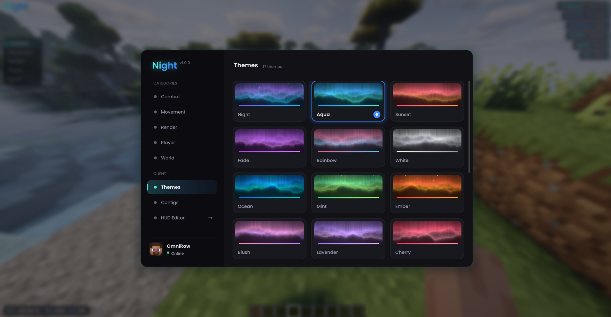
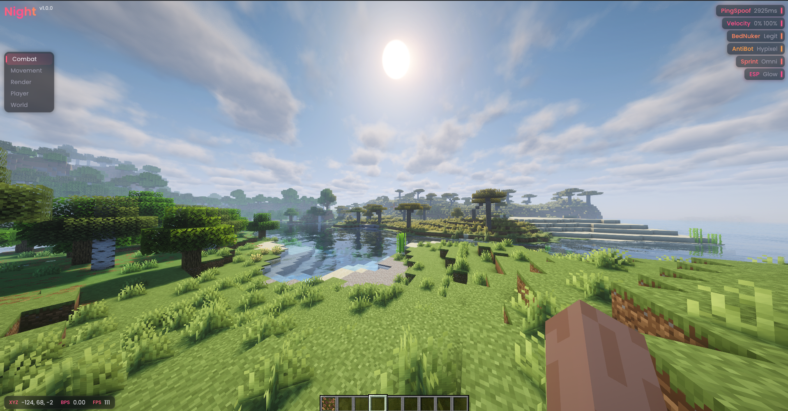
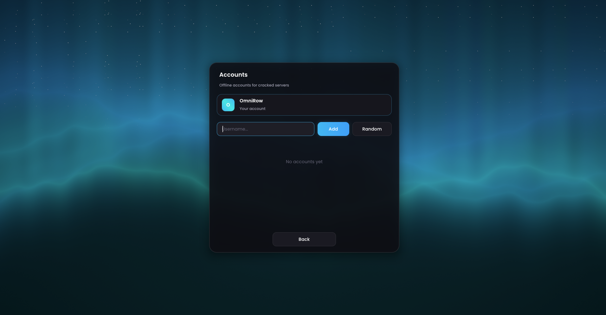

# Night Client

A modern Fabric client for Minecraft **1.21.11** with a fully GPU-rendered interface: smooth
rounded glass panels, real background blur, sharp custom fonts and animations everywhere.



| ClickGUI | Themes |
|---|---|
|  |  |

| In game | Accounts |
|---|---|
|  |  |

## Features

**Interface**
- Rise-style ClickGUI: categories, search, inline settings, tooltips, draggable and scalable window
- 17 themes with live previews, plus a custom accent colour
- Config manager: create, load, save and delete configs in the GUI (auto-saves on close)
- Share configs as a short code: copy it, send it, and anyone can import it (keybinds and HUD layout stay private)
- HUD editor: drag every HUD element anywhere, with snapping
- Aurora shader main menu and an offline account manager
- Glass restyle for vanilla menus (pause menu, server list, options) and chat

**HUD**
- Watermark, animated ArrayList, TabGUI, info bar (XYZ / BPS / FPS)
- TargetHUD (Killaura target) with player head, animated health and damage trail
- Keystrokes with CPS, scoreboard, potion effects, armour and durability
- Toast notifications when modules are toggled
- Music player: now-playing card with album art, progress and controls (Linux, via `playerctl`)
- Minimap with terrain shading, players and waypoints

**Render modules**
- ESP: 2D box, corners or glow outline
- Nametags: glass tags with health, distance and gear
- TargetIndicator: animated ring around your Killaura target
- HitEffects: hit marker and floating damage numbers
- Waypoints: in-world markers with distance, off-screen arrows and an automatic death waypoint
- Silent rotations shown on your player model in third person

## Usage

| Action | How |
|---|---|
| Open the ClickGUI | `Right Shift` |
| Toggle a module | Left click its card |
| Open a module's settings | Right click its card |
| Set a keybind | Middle click a card, or click "Keybind" in its settings, then press a key (`Backspace` clears, `Esc` cancels) |
| Search | Just start typing in the ClickGUI |
| Move the window | Drag its top bar |
| Resize the GUI | `Ctrl` + scroll, or Themes → Customize → GUI Scale |
| Move HUD elements | ClickGUI → HUD Editor (right click an element to reset it) |
| Control music | Open chat, then click the buttons on the music card |

Chat commands use the `.` prefix:

```
.bind <module> <key/none>
.config <save/load/list/delete> [name]
.config export [name]        copy a share code to the clipboard
.config import [code]        import a share code (from the clipboard if no code is given)
.waypoint <add/remove/list/clear> [name] [x y z]
```

## Building

Requires **Java 21+**.

```
./gradlew build
```

The mod jar is written to `build/libs/`. Put it in your `mods` folder together with
[Fabric Loader](https://fabricmc.net/use/) and [Fabric API](https://modrinth.com/mod/fabric-api).

To run a development client: `./gradlew runClient`

## How the rendering works

All client UI goes through one custom shader pipeline (`render/UiPipeline`, shaders in
`assets/night/shaders/core/ui.*`). Every rounded rectangle, outline, shadow, circle and line
is a single quad evaluated with a signed-distance function, so edges are anti-aliased at any size
and scale and drawing is cheap. Text uses a glyph atlas rasterised with STB TrueType at the screen's
real pixel size (`render/UiFont`). Glass panels sample a half-resolution blurred copy of the world
(`render/Blur`).

| Package | Contents |
|---|---|
| `me.night.render` | Shader renderer, fonts, blur, world-to-screen projection |
| `me.night.ui` | ClickGUI, main menu, HUD editor, notifications, glass vanilla menus |
| `me.night.module` | Modules and the module manager |
| `me.night.alt` | Account manager |
| `me.night.mixin` | Minecraft hooks |

`demo/` holds standalone experiments (a terminal gradient demo and an OpenGL pattern-shader viewer)
that are not part of the mod.

## License

[GPL-3.0](LICENSE). You may use, modify and share this code, but anything you distribute that is
based on it must also be released under the GPL-3.0 with its source code.
